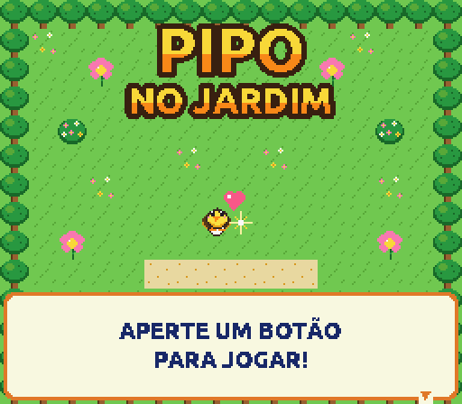
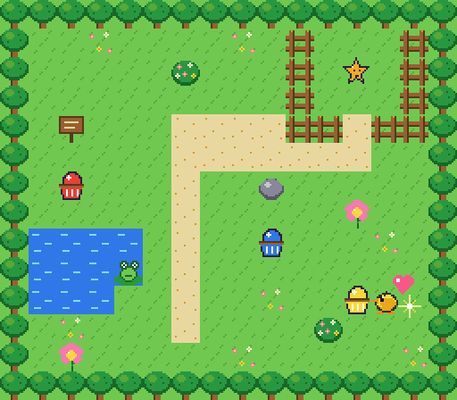
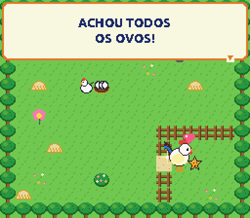
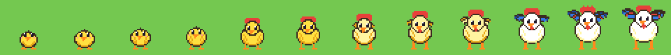
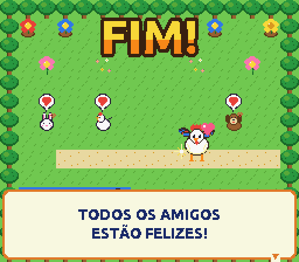

# Pipo no Jardim

Jogo de SNES (`.sfc`) para uma criança de ~3 anos. O pintinho **Pipo** passeia pelo
jardim resolvendo quebra-cabeças simples, sem morte, tempo ou pontuação: errar
simplesmente não faz nada, e acertar faz o Pipo pular com coração e brilhos. Cada fase
termina numa estrela, e a cada estrela o Pipo cresce um pouco, até virar galo.

  

- **Fase 1 — O Jardim:** bolas paradas; cada uma vai na cesta da mesma cor.
- **Fase 2 — Bolas Puladoras:** as bolas quicam e pulam pelo campo; é só encostar para pegar.
- **Fase 3 — Formas:** círculo, quadrado e triângulo vão no buraco do mesmo formato.
- **Fase 4 — Esconde-esconde:** os arbustos soltam folhinhas; três escondem um amigo (coelho, passarinho, ouriço).
- **Fase 5 — Botões e pontes:** pisar num botão colorido faz aparecer a ponte da mesma cor.
- **Fase 6 — Filhotes perdidos:** os patinhos seguem o Pipo em fila até a mamãe pata.
- **Fase 7 — Regar as flores:** pegar o regador e regar 3 brotinhos, que viram flores.
- **Fase 8 — Lanche dos bichinhos:** levar a comida que cada bicho mostra no balão.
- **Fase 9 — Noite dos vaga-lumes:** fase escura; levar os vaga-lumes até as lanternas.
- **Fase 10 — Jardim musical:** tocar os 3 sinos (as flores musicais tocam notas só por diversão).
- **Fase 11 — Os ovos da galinha:** achar os ovos escondidos no feno e levar ao ninho.

**Abertura:** um ovo no ninho balança, racha e o Pipo nasce; aparece o título
PIPO NO JARDIM. Qualquer botão começa (e também pula a animação do ovo).

**Tela final:** depois da fase 11, todos os amigos aparecem felizes, o galo passeia e
canta, com um grande FIM!. Um botão volta para a abertura.

**O Pipo cresce:** a cada estrela ele pisca e fica maior (12 tamanhos, de pintinho a
frango). Na última fase vira um galo e canta "có-có-ri-có". Depois vem a tela final.

## Imagens

| | |
|:---:|:---:|
|  |  |
| **Fase 1:** cada bola na cesta da sua cor | **Fase 2:** as bolas puladoras |
|  |  |
| **Fase 4:** o coelho escondido no arbusto | **Fase 5:** os botões fazem aparecer as pontes |
|  |  |
| **Fase 6:** a fila de patinhos | **Fase 8:** os bichinhos de barriga cheia |
|  |  |
| **Fase 9:** a noite dos vaga-lumes | **Fase 11:** o Pipo vira galo |

**O Pipo crescendo, fase a fase:**

**Tela final:**

  

## Controles
- **Direcional**: anda. Tudo acontece encostando ou pisando nas coisas.
- **Qualquer botão** (A, B, X, Y, Start…): passa o texto da estrela.

## Gerar a ROM
    python3 build.py            # cria pipo.sfc (só precisa de Python 3 + Pillow)
    python3 tools/test_play.py  # joga as 11 fases sozinho (~1 min) e salva capturas em build/shots/

## Onde mexer
| Arquivo | O que tem |
|---|---|
| `title.py`, `ending.py` | mapas e textos da abertura e da tela final |
| `level1.py` … `level11.py` | mapa de cada fase (as letras estão explicadas no topo de cada arquivo), início do Pipo e textos da estrela |
| `tools/growth.py` | desenho dos 12 estágios do Pipo (pintinho → galo) |
| `tools/assets.py` | desenhos (blocos, Pipo, bolas), paletas e o desenho das mensagens (fonte proporcional, tamanho em `TEXT_SIZE`) |
| `build.py` | código do jogo em assembly 65816 (DSL em Python), ordem das fases (`LEVELS`) e montagem da ROM |
| `tools/sound.py` | som: música (`MELODY`, `BASS`), efeitos (`EFFECTS`), instrumento e o driver do SPC700 |
| `tools/spc700.py` | montador SPC700 mínimo, codificador BRR e emulador do SPC usado nos testes |
| `tools/asm65816.py` | montador 65816 mínimo |
| `tools/emu.py` | mini-emulador usado nos testes (não substitui um emulador de verdade) |

## Detalhes técnicos
LoROM 256 KB, modo 1: BG1 é o cenário, BG3 a caixa de texto e os sprites (Pipo em 32×32,
resto em 16×16). Os gráficos do Pipo de cada tamanho e os textos são enviados à
VRAM só quando precisam.

## Som
Uma cantiga de ninar original em loop (melodia + baixo) e efeitos curtos:
pegar algo, acertar, portão/ponte, estrela, patinhos/amigos e folhinhas.
As notas são escritas como `('C5', duração)` em `tools/sound.py` (duração em
centésimos de segundo; `Q` = uma semínima).

As imagens em `docs/img/` saem do teste automático (`build/shots/`).
