# Pipo no Jardim

Jogo de SNES (`.sfc`) para uma criança de ~3 anos. O pintinho **Pipo** passeia pelo
jardim resolvendo quebra-cabeças simples, sem morte, tempo ou pontuação: errar
simplesmente não faz nada, e acertar faz o Pipo pular com coração e brilhos. Cada fase
termina numa estrela, e a cada estrela o Pipo cresce um pouco, até virar galo.

**O vilão: o sapo Cururu.** Um sapo-cururu marrom e travesso, que mora na lagoa, é quem
faz toda a bagunça. No começo de cada fase o jardim aparece arrumado e o Cururu sai
pulando: tira as bolas das cestas, assusta os amigos, quebra as pontes, amassa as
flores, apaga as lanternas... A cada travessura voam folhinhas. No fim ele dá risada,
volta para a lagoa (ou pula para fora do jardim) e aparece uma mensagem contando o
que ele fez, por exemplo "OH, NÃO! O SAPO CURURU ESPALHOU AS BOLAS!". Depois o Pipo
arruma tudo.

**Duas trilhas.** No menu da abertura se escolhe a **trilha do sapo** (as 10 fases do
Cururu) ou a **trilha do Pato Pateta** (5 fases de letras e números). O Pato Pateta é um
pato branco de boné azul, bonzinho mas atrapalhado: no começo de cada fase ele tropeça e
espalha os bloquinhos, e depois fica na fase assistindo (encostar nele faz "quá-quá").

  

- **Fase 1 — O Jardim:** bolas paradas; cada uma vai na cesta da mesma cor.
- **Fase 2 — Bolas Puladoras:** as bolas quicam e pulam pelo campo; é só encostar para pegar.
- **Fase 3 — Formas:** círculo, quadrado e triângulo vão no buraco do mesmo formato.
- **Fase 4 — Esconde-esconde:** o coelho, o passarinho e o ouriço brincam juntos; o Cururu
  chega, eles se assustam e cada um corre para um arbusto **sorteado na hora** (a cada partida
  os esconderijos mudam). Os arbustos soltam folhinhas; achar os três abre o portão.
- **Fase 5 — Botões e pontes:** pisar num botão colorido faz aparecer a ponte da mesma cor.
- **Fase 6 — Filhotes perdidos:** os patinhos seguem o Pipo em fila até a mamãe pata.
- **Fase 7 — Regar as flores:** pegar o regador e regar 3 brotinhos, que viram flores.
  O cenário dessa fase não tem outras plantas (flores, arbustos), só os brotinhos, para
  não confundir a criança.
- **Fase 8 — Lanche dos bichinhos:** levar a comida que cada bicho mostra no balão.
- **Fase 9 — Noite dos vaga-lumes:** fase escura; levar os vaga-lumes até as lanternas.
- **Fase 10 — Os ovos da galinha:** achar os ovos escondidos no feno e levar ao ninho.

### Trilha do Pato Pateta (letras e números)
Bloquinhos azuis são letras e vermelhos são números; todos têm o mesmo formato e a
mesma cor dentro do grupo, então o que diferencia um do outro é só o desenho da letra.

- **Fase 1 — As vogais:** levar A, E, I, O, U para a casinha com a mesma letra, do outro lado do caminho.
- **Fase 2 — Os números:** levar 1, 2, 3, 4, 5 pela ponte até a casinha com o mesmo número.
- **Fase 3 — Contar para atravessar:** pisar nos botões 1, 2 e 3; cada ponte leva ao próximo botão.
- **Fase 4 — Contar as bolinhas:** cada número vai para o cartão com essa quantidade de bolinhas.
- **Fase 5 — Escrever PATO:** levar P, A, T, O para as casinhas ao lado do pato e formar o nome dele.

Nessa trilha o Pipo também cresce a cada estrela (mais depressa, porque são 5 fases) e
vira galo no fim. A tela final dela mostra as vogais, os números e a palavra PATO, com o
galo passeando. A música é a melodia de "Brilha, brilha, estrelinha" / canção do ABC.

(A fase "Jardim musical", com os sinos, foi tirada do jogo; o arquivo ficou guardado em
`extra_fase_musica.py`.)

**Abertura:** um ovo no ninho balança, racha e o Pipo nasce; aparece o título
PIPO NO JARDIM e um menu de três telas, uma depois da outra. Em cada tela o direcional
troca a opção (o coraçãozinho mostra a escolhida) e qualquer outro botão confirma:
1. **Idioma:** português ou inglês.
2. **Som:** com som ou sem som (vale na hora; desliga música e efeitos).
3. **Velocidade do Pipo:** devagar, normal ou rápido. Ele leva 32, 20 ou 12 quadros
   (½ s, ⅓ s, ⅕ s) para andar um bloco. Os valores ficam em `SPEED_FRAMES` no `build.py`.

O jogo lembra as escolhas enquanto estiver ligado, então para começar basta apertar
um botão cinco vezes (idioma, som, velocidade, trilha, fase). Apertar durante o ovo pula a animação.

**Número da fase:** durante a fase, o número dela dentro da trilha (1 a 10, ou 1 a 5) fica no canto superior direito,
grande, branco e com contorno escuro, para aparecer bem em qualquer cenário.

**Tela final:** depois da última fase chegam o papai do Pipo, **Seu Popi** (galo de óculos
e gravata-borboleta), e a mamãe, **Senhora Pipa** (galinha com laço cor-de-rosa). Eles
costuram uma coberta de retalhos para o sapo Cururu, que sai da lagoa tremendo de frio.
Enroladinho e quentinho, ele não faz mais bagunça. Depois todos os amigos aparecem
felizes, o galo passeia e canta, com um grande FIM!. A caixa de texto alterna entre "TODOS OS AMIGOS ESTÃO FELIZES!"
e os autores: **feito por Papai Anselmo e Filho Oliver**. Um botão volta para a abertura.

**O Pipo cresce:** a cada estrela ele pisca e fica maior (12 tamanhos, de pintinho a
frango, distribuídos pelas fases). Na última fase vira um galo e canta "có-có-ri-có". Depois vem a tela final.

## Imagens

| | |
|:---:|:---:|
|  | 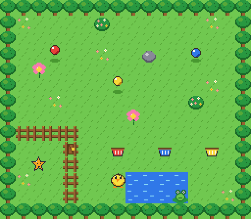 |
| **Fase 1:** cada bola na cesta da sua cor | **Fase 2:** as bolas puladoras |
| 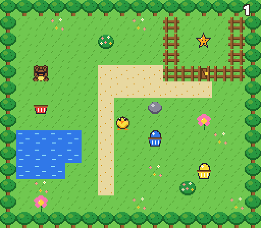 | 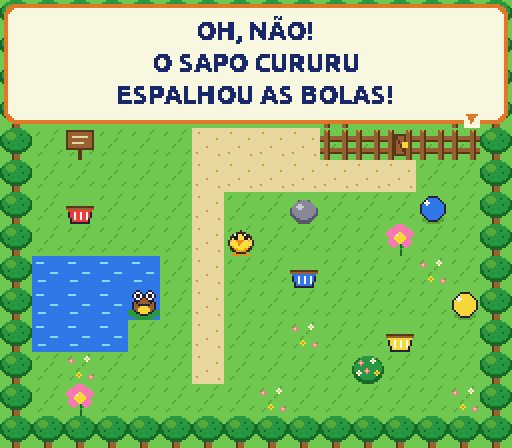 |
| **O sapo Cururu** esvaziando as cestas | **Depois da bagunça:** a mensagem do Cururu |
| 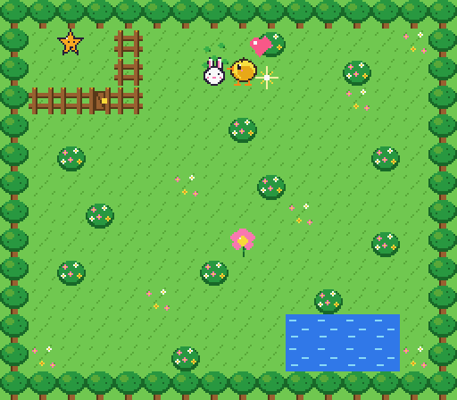 | 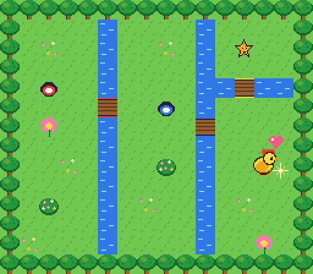 |
| **Fase 4:** o coelho escondido no arbusto | **Fase 5:** os botões fazem aparecer as pontes |
| 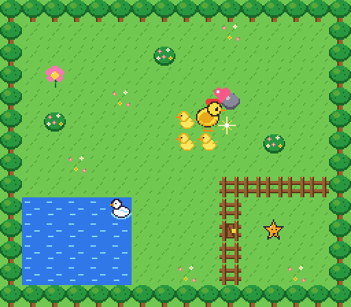 | 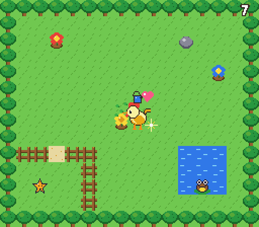 |
| **Fase 6:** a fila de patinhos (cada um olha para o Pipo) | **Fase 7:** só os brotinhos no cenário |
| 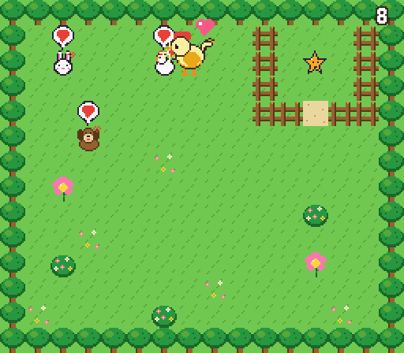 | 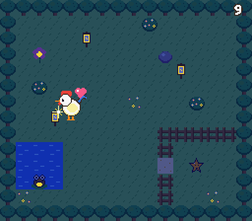 |
| **Fase 8:** os bichinhos de barriga cheia | **Fase 9:** a noite dos vaga-lumes |
| 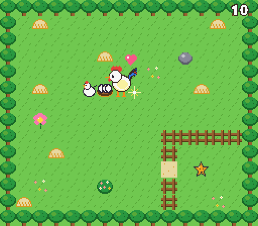 | 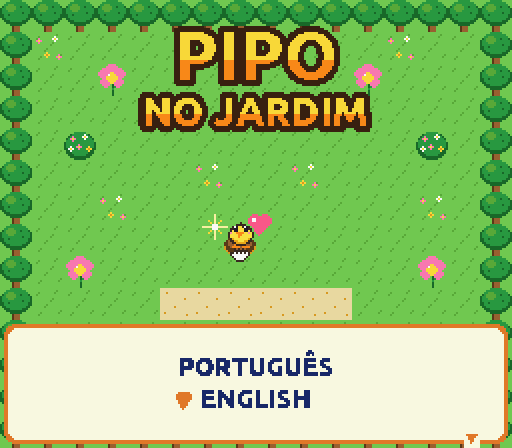 |
| **Fase 10:** os ovos no ninho | **Abertura:** escolha de idioma |
| 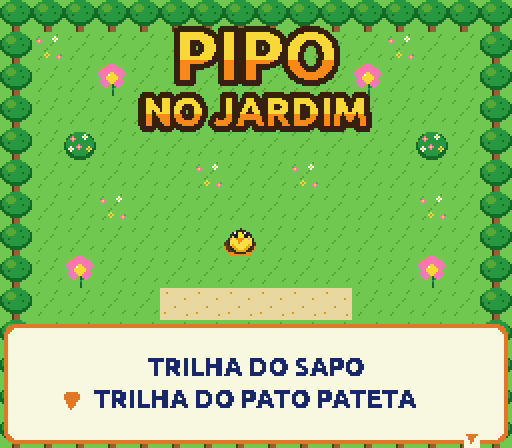 | 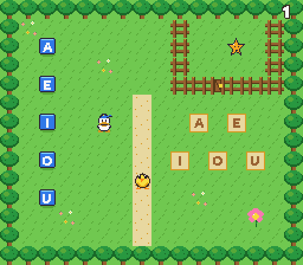 |
| **Abertura:** trilha do sapo ou do Pato Pateta | **Pato Pateta 1:** as vogais e as casinhas |
| 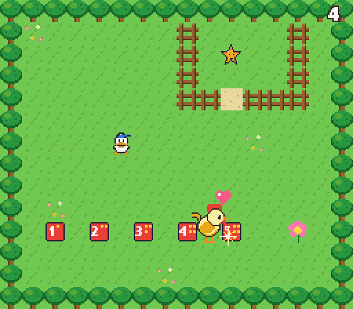 | 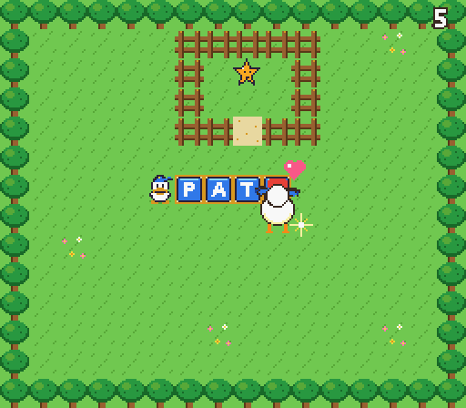 |
| **Pato Pateta 4:** cada número com as suas bolinhas | **Pato Pateta 5:** P, A, T, O |
| 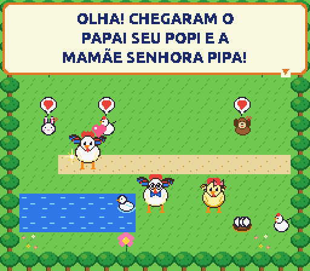 | 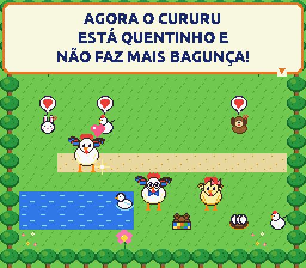 |
| **Final:** chegam Seu Popi e Senhora Pipa | **Final:** o Cururu enroladinho na coberta |

**O Pipo crescendo, fase a fase:**

**Tela final:**

  

## Controles
- **Direcional**: anda. Tudo acontece encostando ou pisando nas coisas.
- **Qualquer botão** (A, B, X, Y, Start…): passa o texto mais rápido. Os diálogos também
  passam sozinhos depois de 5 segundos (`MSG_AUTO_FRAMES` no `build.py`), então a criança
  não fica presa numa mensagem.
- **No menu da abertura:** direcional troca a opção, qualquer outro botão confirma.

## Gerar a ROM
    python3 build.py            # cria pipo.sfc (só precisa de Python 3 + Pillow)
    python3 tools/test_play.py  # joga as duas trilhas e os finais sozinho (~5 min) e salva capturas em build/shots/
    python3 tools/test_play.py pato  # só a trilha do Pato Pateta (~1,5 min)

## Onde mexer
| Arquivo | O que tem |
|---|---|
| `title.py`, `ending.py` | mapas e textos da abertura (incluindo as telas do menu, `MENU`) e da tela final (a cena do papai e da mamãe fica em `ending_cutscene`, no `build.py`) |
| `level1.py` … `level10.py` | mapa de cada fase (as letras estão explicadas no topo de cada arquivo), início do Pipo, o caminho do sapo (`CURURU`: as letras do mapa que ele visita, em ordem) e os textos em português (`MESSAGES`, incluindo `intro`, a mensagem do sapo) e inglês (`MESSAGES_EN`) |
| `pato1.py` … `pato5.py`, `ending2.py` | fases e tela final da trilha do Pato Pateta. Igual às outras, mais: `VISITOR = 'pato'`, `GOAL` (quantas entregas abrem o portão) e `CHARS` (letras do mapa que só valem naquela fase). Em `CURURU`, uma parada com duas letras (`'aA'`) muda as duas de uma vez |
| `tools/growth.py` | desenho dos 12 estágios do Pipo (pintinho → galo) |
| `tools/assets.py` | desenhos (blocos, Pipo, bolas), paletas e o desenho das mensagens (fonte proporcional, tamanho em `TEXT_SIZE`) |
| `build.py` | código do jogo em assembly 65816 (DSL em Python), as trilhas e a ordem das fases (`TRAILS`), como cada coisa estava antes do sapo bagunçar (`CURURU_TIDY`) e montagem da ROM |
| `tools/sound.py` | som: música (`MELODY`, `BASS`), efeitos (`EFFECTS`), instrumento e o driver do SPC700 |
| `tools/spc700.py` | montador SPC700 mínimo, codificador BRR e emulador do SPC usado nos testes |
| `tools/asm65816.py` | montador 65816 mínimo |
| `tools/emu.py` | mini-emulador usado nos testes (não substitui um emulador de verdade) |

## Detalhes técnicos
LoROM 512 KB, modo 1: BG1 é o cenário, BG3 a caixa de texto e os sprites (Pipo em 32×32,
resto em 16×16). Os gráficos do Pipo de cada tamanho e os textos são enviados à
VRAM só quando precisam.

## Som
A música de fundo é a melodia da cantiga folclórica **"Sapo Cururu"** (domínio público),
em loop com um baixo simples (na trilha do Pato Pateta toca "Ah! vous dirai-je, maman",
também em domínio público: `MELODY2`, `BASS2`), e há efeitos curtos:
pegar algo, acertar, portão/ponte, estrela, patinhos/amigos e folhinhas.
As notas são escritas como `('C5', duração)` em `tools/sound.py` (duração em
centésimos de segundo; `Q` = uma semínima).

As imagens em `docs/img/` saem do teste automático (`build/shots/`).
